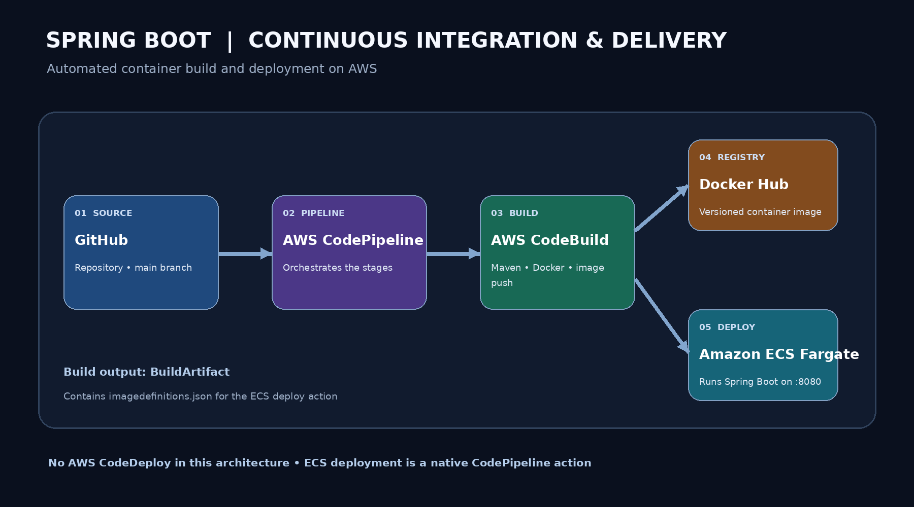
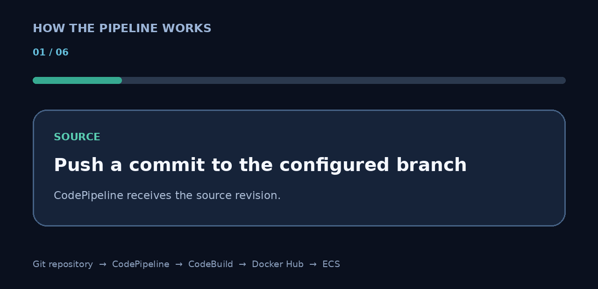

<div align="center">

# Spring Boot CI/CD on AWS

### Automated Docker build and deployment with AWS CodePipeline, CodeBuild and ECS Fargate

<p>
  
</p>

<p>
  
</p>

**Commit → Build → Containerize → Push → Deploy**

</div>

---

## Overview

This project demonstrates an automated CI/CD workflow for a Java Spring Boot application. When a change is pushed to the configured source branch, AWS CodePipeline orchestrates the workflow, AWS CodeBuild packages the application and builds a Docker image, Docker Hub stores the image, and Amazon ECS on AWS Fargate runs the updated container.

The ECS deployment is performed using the **Amazon ECS deploy action built into AWS CodePipeline**. **AWS CodeDeploy is not used in this project.**

## Architecture

| Stage | Service | Responsibility |
|---|---|---|
| Source | GitHub or configured source provider | Stores application source code |
| Orchestration | AWS CodePipeline | Connects and runs pipeline stages |
| Build | AWS CodeBuild | Runs Maven, builds Docker image and pushes it |
| Registry | Docker Hub | Stores versioned Docker images |
| Deployment | Amazon ECS Fargate | Runs the Spring Boot container |
| Build artifact | Amazon S3 via CodePipeline | Stores pipeline artifacts, including image definitions |

## Repository structure

The Java application is kept in its own subdirectory:

```text
Sample_CICD_Project/
└── java-springboot-ci-demo/
    ├── src/
    │   └── main/
    │       └── java/
    ├── pom.xml
    ├── Dockerfile
    └── buildspec.yml
```

During a CodeBuild run, `imagedefinitions.json` is generated at the repository workspace root and included in the build output artifact. It is generated by the build; it does not need to be committed to Git.

## Technology stack

- **Java 17** – application runtime
- **Spring Boot** – Java application framework
- **Maven** – build and package management
- **Docker** – container image creation
- **Docker Hub** – image registry
- **AWS CodePipeline** – CI/CD orchestration
- **AWS CodeBuild** – build automation
- **Amazon ECS with AWS Fargate** – container deployment
- **AWS Systems Manager Parameter Store** – Docker Hub credentials for CodeBuild
- **Amazon S3** – pipeline artifact storage
- **Amazon CloudWatch** – build and container logs
- **AWS IAM** – service permissions

---

## 1. Prerequisites

Before starting, make sure you have:

- An AWS account with permissions to create the required resources.
- A Git repository connected to CodePipeline.
- A Java 17 Spring Boot application built with Maven.
- A Docker Hub account and repository.
- An ECS task execution role.
- A CodeBuild environment that supports Java 17 and Docker.
- Docker build **Privileged mode enabled** in the CodeBuild environment.

> AWS Free Tier eligibility and service allowances vary. Fargate, public IPv4 addresses, load balancers, NAT Gateways, S3, and CloudWatch may incur charges. Review the [AWS pricing pages](https://aws.amazon.com/pricing/) before deploying.

## 2. Prepare the Spring Boot application

From the application directory, build the project:

```bash
cd java-springboot-ci-demo
mvn clean package
```

The generated JAR is placed in:

```text
target/
```

### Dockerfile

Create `java-springboot-ci-demo/Dockerfile`:

```dockerfile
FROM eclipse-temurin:17-jre

WORKDIR /app

COPY target/*.jar app.jar

EXPOSE 8080

ENTRYPOINT ["java", "-jar", "app.jar"]
```

The container exposes port `8080`, which must match the ECS task definition and service networking configuration.

## 3. Store Docker Hub credentials securely

Do not hard-code Docker Hub credentials in the buildspec or commit them to Git.

In **AWS Systems Manager → Parameter Store**, create:

| Parameter | Type | Value |
|---|---|---|
| `/CodeBuild/dockerhub-username` | String or SecureString | Docker Hub username |
| `/CodeBuild/dockerhub-token` | SecureString | Docker Hub access token |

Use a Docker Hub access token with permission to push to the repository. The CodeBuild service role must be allowed to read these parameters using `ssm:GetParameters`. If you use a customer-managed KMS key, the role may also require `kms:Decrypt`.

## 4. Configure AWS CodeBuild

Create a CodeBuild project named:

```text
java-springboot-docker-build
```

Recommended configuration:

| Setting | Value |
|---|---|
| Environment | Managed Linux image |
| Runtime | Java 17 / `corretto17` |
| Buildspec path | `java-springboot-ci-demo/buildspec.yml` |
| Privileged mode | Enabled |
| Service role | Dedicated CodeBuild IAM role |

Choose a currently supported CodeBuild standard image that provides Java 17. The build environment needs Docker support and permission to write logs, read the SSM parameters, and publish the build artifact.

When CodeBuild is invoked by CodePipeline, the pipeline provides the source artifact to the build action.

## 5. Buildspec configuration

Create `java-springboot-ci-demo/buildspec.yml`:

```yaml
version: 0.2

env:
  variables:
    IMAGE_NAME: java-springboot-ci-demo
  parameter-store:
    DOCKERHUB_USERNAME: /CodeBuild/dockerhub-username
    DOCKERHUB_TOKEN: /CodeBuild/dockerhub-token

phases:
  install:
    runtime-versions:
      java: corretto17
    commands:
      - java -version
      - mvn -version

  pre_build:
    commands:
      - echo "$DOCKERHUB_TOKEN" | docker login --username "$DOCKERHUB_USERNAME" --password-stdin

  build:
    commands:
      - cd "$CODEBUILD_SRC_DIR/java-springboot-ci-demo"
      - mvn -B clean package
      - docker build -t "$DOCKERHUB_USERNAME/$IMAGE_NAME:$CODEBUILD_RESOLVED_SOURCE_VERSION" .
      - docker tag "$DOCKERHUB_USERNAME/$IMAGE_NAME:$CODEBUILD_RESOLVED_SOURCE_VERSION" "$DOCKERHUB_USERNAME/$IMAGE_NAME:latest"

  post_build:
    commands:
      - docker push "$DOCKERHUB_USERNAME/$IMAGE_NAME:$CODEBUILD_RESOLVED_SOURCE_VERSION"
      - docker push "$DOCKERHUB_USERNAME/$IMAGE_NAME:latest"
      - printf '[{"name":"spring-boot-container","imageUri":"%s"}]' "$DOCKERHUB_USERNAME/$IMAGE_NAME:$CODEBUILD_RESOLVED_SOURCE_VERSION" > "$CODEBUILD_SRC_DIR/imagedefinitions.json"
      - docker logout

artifacts:
  files:
    - imagedefinitions.json
```

### What happens in each phase?

| Phase | What it does |
|---|---|
| `install` | Checks Java and Maven versions |
| `pre_build` | Logs in to Docker Hub using Parameter Store credentials |
| `build` | Packages the Spring Boot JAR and builds the Docker image |
| `post_build` | Pushes the versioned and `latest` tags, then creates `imagedefinitions.json` |
| `artifacts` | Includes `imagedefinitions.json` in the CodeBuild output artifact |

The image is tagged with `CODEBUILD_RESOLVED_SOURCE_VERSION` so each source revision has a distinct tag. The `latest` tag is also pushed for initial setup and manual testing.

> **Container name requirement:** `spring-boot-container` in the JSON must exactly match the container name in the ECS task definition.

## 6. Create the ECS cluster and task definition

### Create the cluster

In **Amazon ECS → Clusters → Create cluster**:

```text
Cluster name: java-springboot-cluster
Infrastructure: AWS Fargate
```

### Create the task definition

In **ECS → Task definitions → Create new task definition**, use:

| Setting | Example |
|---|---|
| Family | `spring-boot-task` |
| Launch type | Fargate |
| OS / architecture | Linux / x86_64 |
| CPU | `0.25 vCPU` |
| Memory | `0.5 GB` |
| Task execution role | `ecsTaskExecutionRole` |
| Container name | `spring-boot-container` |
| Image | `<DOCKERHUB_USERNAME>/java-springboot-ci-demo:latest` |
| Container port | `8080` |
| Protocol | TCP |

The CPU and memory values are an example Fargate combination; select a supported size in the AWS console.

### Docker Hub repository access

- **Public repository:** ECS can pull the image without Docker Hub credentials.
- **Private repository:** configure repository credentials using AWS Secrets Manager and grant the ECS task execution role access to the secret. The SSM parameters used by CodeBuild do not automatically authenticate ECS.

## 7. Create the ECS service

In **ECS → Clusters → `java-springboot-cluster` → Create service**:

| Setting | Example |
|---|---|
| Compute | Fargate |
| Task definition | `spring-boot-task` |
| Service name | `spring-boot-service` |
| Desired tasks | `1` |
| Subnets | Public subnets for direct public-IP demo |
| Auto-assign public IP | Enabled for direct public-IP demo |

For direct public-IP access, the task security group needs inbound TCP port `8080`. For a temporary demo this may be opened to `0.0.0.0/0`; restrict access for a real application. The selected public subnets must have a route to an Internet Gateway.

Create the service and wait until the task is `RUNNING`.

## 8. Create AWS CodePipeline

Create a pipeline named:

```text
java-springboot-ci-pipeline
```

Use a pipeline service role and configure the stages below.

### Source stage

Connect the repository and select the branch to monitor.

| Setting | Example |
|---|---|
| Provider | GitHub via GitHub App, or the source provider actually used |
| Repository | `gokul-200/Sample_CICD_Project` |
| Branch | `main` |
| Output artifact | `SourceArtifact` |

Enable source change detection / the source trigger so new commits start the pipeline.

### Build stage

Add an action group:

| Setting | Value |
|---|---|
| Action name | `BuildAndPushDockerImage` |
| Action provider | AWS CodeBuild |
| Region | Region where the CodeBuild project exists |
| Project | `java-springboot-docker-build` |
| Input artifact | `SourceArtifact` |
| Output artifact | `BuildArtifact` |

### Deploy stage

Add the **Amazon ECS** deployment action provided by CodePipeline:

| Setting | Value |
|---|---|
| Action provider | Amazon ECS |
| Cluster | `java-springboot-cluster` |
| Service | `spring-boot-service` |
| Input artifact | `BuildArtifact` |
| Image definitions file | `imagedefinitions.json` |

### Artifact flow — important

```text
Source stage
  Output: SourceArtifact
       |
       v
Build stage (CodeBuild)
  Input:  SourceArtifact
  Output: BuildArtifact
       |
       v
Deploy stage (Amazon ECS action)
  Input: BuildArtifact
  Reads: imagedefinitions.json
```

The Deploy action must consume **`BuildArtifact`**, not `SourceArtifact`. The image definitions file is generated by CodeBuild and included in the build output artifact.

### Pipeline IAM permissions

The CodePipeline service role must be allowed to invoke the CodeBuild project. A scoped policy example is:

```json
{
  "Version": "2012-10-17",
  "Statement": [
    {
      "Effect": "Allow",
      "Action": [
        "codebuild:StartBuild",
        "codebuild:BatchGetBuilds"
      ],
      "Resource": "arn:aws:codebuild:REGION:ACCOUNT_ID:project/java-springboot-docker-build"
    }
  ]
}
```

Replace `REGION` and `ACCOUNT_ID` with the actual CodeBuild project region and AWS account ID. The pipeline role also needs the permissions required for its artifact bucket and ECS deployment action, including `iam:PassRole` where required. Avoid using broad administrator permissions as a shortcut.

## 9. Understand `imagedefinitions.json`

This is the small file that tells the ECS deploy action which image should be used for the named container.

The buildspec generates it at the root of the CodeBuild workspace:

```text
Sample_CICD_Project/
├── java-springboot-ci-demo/
│   ├── buildspec.yml
│   ├── Dockerfile
│   └── pom.xml
└── imagedefinitions.json   # generated during build
```

Example:

```json
[
  {
    "name": "spring-boot-container",
    "imageUri": "dockerhub-user/java-springboot-ci-demo:COMMIT_ID"
  }
]
```

- `name` identifies the container in the ECS task definition.
- `imageUri` identifies the Docker image and tag to deploy.

You normally will not see this file in GitHub because CodeBuild creates it during the build and packages it into `BuildArtifact`.

## 10. Run and verify the pipeline

### Start a manual execution

1. Open **AWS CodePipeline → Pipelines**.
2. Select `java-springboot-ci-pipeline`.
3. Select **Release change**.
4. Wait for Source, Build and Deploy to finish.

### Verify the build

- Open CodeBuild build history and inspect the logs.
- Confirm Maven completes successfully.
- Confirm Docker image push succeeds.
- Check Docker Hub → repository → Tags for the commit-specific image tag.
- Confirm `BuildArtifact` contains `imagedefinitions.json`.

### Verify ECS

Open:

**ECS → Clusters → `java-springboot-cluster` → Services → `spring-boot-service`**

Check that the desired task is running and the service deployment has stabilized.

For direct public-IP access, open the running task details, copy its public IP, and test:

```text
http://PUBLIC_IP:8080/
```

The response should come from the Spring Boot application's `/` endpoint.

## 11. Automatic deployment after code changes

Once source change detection is enabled, pushing a commit to the monitored branch starts a new pipeline execution.

```bash
git add .
git commit -m "Update Spring Boot application"
git push origin main
```

The automated workflow:

1. CodePipeline detects the new source revision.
2. CodeBuild runs Maven.
3. Docker builds a new image using the source revision as its tag.
4. CodeBuild pushes the image to Docker Hub.
5. CodeBuild generates `imagedefinitions.json`.
6. The ECS deploy action updates the service to use the new image.

If a build or deployment fails, inspect the failed action's logs before retrying.

## 12. Stable URL: why the ECS public IP changes

With direct Fargate public-IP access, a task can receive a different public IP when ECS replaces it during a deployment. This is expected.

For a stable website address, place an **Application Load Balancer (ALB)** in front of the ECS service:

```text
Browser
   |
   v
Application Load Balancer (stable DNS)
   |
   v
ECS Fargate service
   |
   v
Spring Boot container :8080
```

High-level setup:

1. Create an internet-facing ALB in the same VPC, across at least two public subnets.
2. Create an IP target group using HTTP port `8080`.
3. Configure the health check path as `/`.
4. Add an HTTP listener on port `80` (HTTPS needs a certificate).
5. Update the ECS service to register tasks with the target group.
6. Allow inbound web traffic on the ALB security group.
7. Allow port `8080` on the ECS task security group only from the ALB security group.
8. Once verified, disable public IP assignment on ECS tasks if the network design permits.

The ALB DNS name remains stable when ECS replaces tasks. **An ALB has ongoing charges**, so review regional pricing before creating one.

## 13. Troubleshooting

| Error / symptom | What to check |
|---|---|
| `imagedefinitions.json` not found | Buildspec creates it at `$CODEBUILD_SRC_DIR`; artifacts include it; Deploy input is `BuildArtifact` |
| `codebuild:StartBuild` AccessDenied | Add scoped `StartBuild` and `BatchGetBuilds` permissions to the CodePipeline service role |
| Concurrent build limit exceeded | Wait for the active build to finish; avoid repeated manual releases |
| Docker build fails | Enable CodeBuild privileged mode; confirm Dockerfile and JAR paths |
| Docker Hub login/push fails | Check Parameter Store names, token permissions and CodeBuild SSM access |
| ECS cannot pull image | Check image URI/tag, repository visibility, registry credentials and task network access |
| ECS task stops or is unhealthy | Inspect CloudWatch container logs, port mapping, security groups and task execution role |
| `corretto17` unavailable | Select a supported CodeBuild image with Java 17 runtime |

### Common artifact mistake

Incorrect:

```text
Source → Deploy
```

Correct:

```text
Source → Build → Deploy
         |
         └── BuildArtifact contains imagedefinitions.json
```

## 14. Cost awareness and cleanup

AWS Free Tier allowances vary by account, region, service and date. Do not assume that Fargate, load balancers, NAT Gateways, public IPv4 addresses, S3, or CloudWatch are free.

When the demo is no longer needed:

1. Disable the pipeline source trigger and delete the CodePipeline.
2. Delete the ECS service (or set desired count to zero first) to stop Fargate tasks.
3. Delete the ECS cluster after its services are removed.
4. Delete project-specific load balancers, target groups, NAT Gateways and unused Elastic IP addresses, if any.
5. Delete the CodeBuild project after builds have stopped.
6. Empty and delete the project-specific S3 artifact bucket if no longer needed.
7. Delete project-specific CloudWatch log groups if logs are no longer needed.
8. Delete the Docker Hub parameters from Parameter Store if no longer needed.
9. Review all regions where resources were created.
10. Check AWS Billing and Cost Explorer for remaining usage.

Do not delete shared VPCs, IAM roles, security groups, S3 buckets or other resources used by unrelated projects. IAM roles generally do not incur direct charges, so they may be retained for reuse.

## 15. Useful AWS console locations

| What you need | AWS console |
|---|---|
| Pipeline execution | CodePipeline → Pipelines |
| Build logs | CodeBuild → Build projects → Build history |
| Build project settings | CodeBuild → Build projects |
| ECS tasks and services | ECS → Clusters |
| Task definitions | ECS → Task definitions |
| Container logs | CloudWatch → Log groups |
| Docker credentials | Systems Manager → Parameter Store |
| Pipeline artifact ZIP | S3 → pipeline artifact bucket |
| Service permissions | IAM → Roles |
| Usage and charges | Billing → Cost Explorer |

---

## Project checklist

- [ ] Spring Boot application builds with Maven.
- [ ] Docker image builds successfully.
- [ ] Docker Hub credentials are stored securely.
- [ ] CodeBuild privileged mode is enabled.
- [ ] CodeBuild pushes the image to Docker Hub.
- [ ] `imagedefinitions.json` is generated and included in `BuildArtifact`.
- [ ] CodePipeline Build action consumes `SourceArtifact`.
- [ ] ECS Deploy action consumes `BuildArtifact`.
- [ ] ECS container name matches the JSON container name.
- [ ] ECS service reaches a stable running state.
- [ ] Application endpoint responds successfully.
- [ ] A new source commit triggers the pipeline automatically.

---

<div align="center">

**Built to learn and demonstrate automated CI/CD for a containerized Spring Boot application on AWS.**

</div>
